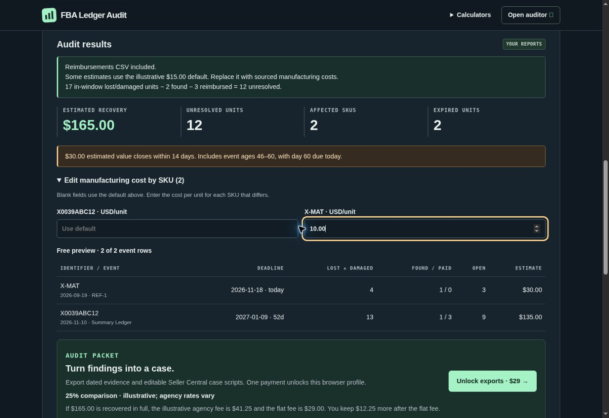

# FBA Ledger Audit | Phase 5 release report

November 18, 2026 · Production branch `main` · [Open the auditor](https://fba-ledger-audit.pages.dev/)

The release keeps the existing $29 one-time product. A seller can now import multiple files, review an immediate estimate, correct their manufacturing costs, see upcoming deadlines, and preview the evidence a paid packet contains. The public site has 14 standalone calculators and the auditor. Cloudflare Pages serves the repository root with no build step.

## Release history

| Phase | Commit | Result |
| --- | --- | --- |
| 0 | [178806d](https://github.com/carriercompliancesystems/fba-ledger-audit/commit/178806d7de3b7b55f31c60b09f5ff3a7390be27f) | Inspection and pricing proposal on `review/phase-0`. |
| 1 | [9d5446f](https://github.com/carriercompliancesystems/fba-ledger-audit/commit/9d5446fc82ec8403addfffb522dd15c05eb4b26d) | Static homepage, shared design, retained checkout and tab-local checkout snapshot. |
| 2 | [1ad0c22](https://github.com/carriercompliancesystems/fba-ledger-audit/commit/1ad0c22ad29e529d05a4905bf138274d6052e2e3) | Multi-report reconciliation, per-SKU prices, deadline estimates, downloads and fixtures. |
| 3 | [454190a](https://github.com/carriercompliancesystems/fba-ledger-audit/commit/454190a23f430caa12427875381a55210b6ae8ba) | Fourteen interactive calculators and the legacy storage redirect. |
| 4 | [a3bbd85](https://github.com/carriercompliancesystems/fba-ledger-audit/commit/a3bbd8541bd64c17d696309350c2bed8c4ae39fa) | Crawler files, canonical pages, internal link checks, editable refund window and regression tests. |
| Final buyer-flow check | [ff923fc](https://github.com/carriercompliancesystems/fba-ledger-audit/commit/ff923fcc9f29cfd03a70ddedaed6d495f266c59c) | Buyers can read a fictional case in the demo and open the real multi-file picker from the same panel. |
| 5 | This report and its browser screenshot | Verification results, commercial assumptions, file manifest and operating limits. |

Cloudflare Pages marked the application deployment successful. [Production deployment check](https://github.com/carriercompliancesystems/fba-ledger-audit/runs/135149103388)

## Stripe and protected files

The existing Stripe Payment Link displayed **FBA 60-Day Claim-Ready Audit Packet (Full CSV + Case Scripts)** at **$29.00** before any applicable tax. The number of new products, prices and links required is **zero**. The active URL is `https://buy.stripe.com/5kQeVc9ty6Mg8NSevtbwk02`. Its configuration is on **line 3** of `assets/auditor.js` and `priceUSD: 29` is on **line 4**. [Checkout configuration](../../assets/auditor.js#L3)

The expected success URL is `https://fba-ledger-audit.pages.dev/?session_id={CHECKOUT_SESSION_ID}`. The client asks `/api/verify?session_id=…` for the payment result and writes `localStorage.setItem("fba_audit_unlocked", "true")` on a paid response. It restores the dated findings and entered costs from tab-local storage. The session ID is removed from the address bar after a successful persistent unlock. [Payment return code](../../assets/payment.js)

| Protected file | Verified original and release Git blob |
| --- | --- |
| `functions/api/verify.js` | `311b97e1d04d5d8e54a6403b78fd667824765e56` |
| `google9ebc526afdbadcaa.html` | `2a747d9887d42dfa8b36918f740af7f719ef8b6c` |

## Verification

| Check | Observed result |
| --- | --- |
| Automated audit, calculator and payment tests | **37 passed.** Coverage includes BOMs, quoted commas, escaped quotes, embedded line breaks, blank files, missing columns, invalid and ambiguous dates, credits, duplicate or overlapping data, SKU alias conflicts, 45/46/60/61 boundaries, case grouping, CSV escaping, calendar dates and mocked paid/unpaid responses. |
| Production browser, all three fixtures together | The page identified all three report types. It showed 17 in-window lost/damaged units, two found, three reimbursed, 12 open and two expired. The $15 default gave **$180 total and $45 expiring**. Changing X-MAT to $10 gave **$165 total and $30 expiring**. The illustrative fee comparison changed to $41.25 versus $29, a $12.25 difference. |
| Supplied tumbler row | The row alone produced 12 units and $180. Three matched reimbursed units reduced the SKU to nine units and $135. |
| Demo and retention | The relative-date sample showed $255 total and $180 expiring at the default. Its sample script included a reference, the source row and the filing disclaimer. The sample’s file picker opened a real Summary CSV. The browser downloaded the calendar reminder. |
| Checkout and return | The live paid-export button opened the correct merchant, item and $29 subtotal. Returning from checkout and refreshing restored the $165 audit and $30 deadline estimate. Paid, unpaid, unavailable-verifier and previously unlocked branches passed controlled tests. The live verifier returned HTTP 400 with `paid: false` for a missing ID. |
| Live calculators | All 14 displayed a result and two comparison bars. Changing the dimensional divisor from 139 to 100 changed 4.03 lb to 5.6 lb. Changing the refund example’s waiting threshold from 45 to 59 changed the result from six days left to 20. |
| Search and links | The local check passed **269 HTML link and asset references**, 14 menu destinations, unique titles/descriptions/canonicals, FAQ text-to-schema matches, anchors, JS imports, protected hashes, redirects, sitemap and crawler coverage. Both `sitemap.xml` and `llms.txt` list all 15 canonical content pages. |
| Public HTTP routes | **44 of 44** matched the expected results across the 15 canonical pages, 14 current calculator `.html` aliases, six assets, four crawler/ownership files, two legacy paths, the verifier and the two supplied external sources. Both old storage addresses landed on the new storage calculator. |

Reproduce the source checks from the repository root with `node --test .github/qa/*.test.mjs` and `python3 .github/qa/links.py`. [Test checklist](../qa/checklist.md)

## Product assumptions and limitations

- **Input scope.** Each audit represents one store, marketplace, currency and comparable report period. The supplied English Summary, Detailed and Reimbursements headers define the supported formats. The reader accepts UTF-8 comma-separated data with a BOM, quoted cells and common date formats. Ambiguous numeric dates require the seller to select month-first or day-first. Different locales, delimiters and event reason codes may need a new mapping.
- **Matching.** The engine prefers FNSKU and accepts unambiguous MSKU/SKU aliases. It uses the total reimbursed quantity when populated, then inventory quantity or the generic quantity. It counts identical file content once, rejects overlapping ledger ranges for the same SKU and requests one reimbursement export per SKU. A generic quantity-column report assumes the seller selected a reimbursement export. Reversals, contradictory totals and ambiguous identifiers require review.
- **Timing and attribution.** The browser’s local calendar date sets the review date. Day zero is the event date, day 60 remains in the window, and ages 46–60 trigger urgency. The engine matches reference-linked credits first. A dated found event applies only to losses on or before that date. Where a credit lacks a unique event match, the engine uses a conservative SKU-level allocation and shows a range when expiry exposure varies. Summary rows can represent a period. Confirm the underlying adjustment date and any pooled offsets before filing.
- **Valuation.** The $15 default is illustrative. A changed default or SKU override records the seller’s input. The estimate uses unresolved units and sourced manufacturing cost in USD. Amazon decides claim eligibility and actual reimbursement. A balance variance, fee-calculator result, or missing reimbursement CSV calls for further verification.
- **Filing guidance.** The 45-day refund wait through day 45 and the day-120 end are editable defaults. One supplied source gives different windows by marketplace. The inbound calculator models nine calendar months from delivery and clamps a month-end date where needed. Sellers must check account-specific eligibility, exact menu labels, documentation, dates and rate tiers. Five distinct identifiers per case is the product’s grouping rule. Its effect on case closures has not been validated. [Supplied policy background](https://www.sellerforge.ai/blog/amazon-profitability-audit-fee-leakage) · [Supplied window-change background](https://www.spscommerce.com/community/articles/amazon-reimbursement-policy)
- **Fee assumptions.** The dimensional divisor starts at 139 and the supply benchmark at 28 days. Seller-entered fee rates, assessed units, dates and confirmed tiers control the calculations. The 25% comparison assumes equal actual recovered amounts across the two approaches and compares fees only. At $116 recovered the fees are equal. At $80 the flat fee costs $9 more, and at $400 it costs $71 less. Agency rates and services vary.
- **Privacy and access.** FileReader, reconciliation, pricing and export generation run on the device. Checkout temporarily stores derived findings and costs in the tab. Clearing the audit clears this snapshot. Returning on a different day requires refreshed reports. The permanent unlock is client-side and browser-profile-specific. The protected verifier checks the Stripe session’s paid status without a product-specific entitlement check. Clearing storage, switching profiles and browser storage limits can affect access or restoration.
- **Remaining live limits.** The hosted price and checkout handoff were observed. The Stripe Dashboard success-redirect setting and the complete live paid transaction were unverified. No charge was made. Paid file generation and contents were tested with fixtures. No real seller’s production exports, Amazon claim submission, case acceptance or recovery outcome was tested. Desktop Chromium was exercised. Native drag gestures across operating systems, mobile Safari/Firefox, calendar-client imports and very large production exports were outside the browser checks. Large reports are processed in browser memory and reconciliation can slow down when many credits affect one SKU.
- **Discovery.** The named bots are allowed in `robots.txt`. A working sitemap, FAQ markup and `llms.txt` do not establish indexation, search volume, AI referrals or paid conversions. No paid tooling, paid ads, outreach pipeline or new server was introduced. No Search Console, Stripe analytics or traffic account was used to estimate sales.

## 180-day commercial decision

Keep FBA for this launch. A seller publicly described the exact problem of identifying inventory that remained missing after recoveries and reimbursements. A browser-local bank-statement converter, one plausible alternative, already has competing free conversion tiers. The available evidence shows the FBA problem exists. It does not measure willingness to buy this specific packet or establish a higher expected return from a pivot. [Seller discussion](https://sellercentral.amazon.com/seller-forums/discussions/t/b90ebaae-d57a-426a-857b-5a6b08bd3f78?mons_sel_locale=en_US) · [Alternative-market example](https://csvledger.com/)

| Scenario | New organic visitors | Finish a real audit | Finished audit with priced, in-window finding | Buy among that group | Expected sales | Gross at $29 |
| --- | ---: | ---: | ---: | ---: | ---: | ---: |
| Low | 500 | 8% | 25% | 10% | 1 | $29 |
| Base | 2,500 | 12% | 40% | 10% | 12 | $348 |
| High | 10,000 | 20% | 50% | 15% | 150 | $4,350 |

Each row multiplies the four funnel inputs by $29. All traffic and conversion figures are hypothetical. The period is the first 180 days after launch, with search/AI referrals only, $0 acquisition spend, at most one purchase per buyer, zero revenue assigned to demo runs or repeats, and gross receipts before processor fees, refunds and taxes. The scenarios have no probability weights. Zero sales remain possible.

## File manifest

The following paths cover the cumulative production diff from `c742c45`, including the Phase 5 evidence. The separate Phase 0 branch added `docs/phase-0-review.md`.

| Status | Repository path |
| --- | --- |
| Added | `.github/qa/audit-in-browser.jpg` |
| Added | `.github/qa/auditor.test.mjs` |
| Added | `.github/qa/calculators.test.mjs` |
| Added | `.github/qa/checklist.md` |
| Added | `.github/qa/fixtures/detailed.csv` |
| Added | `.github/qa/fixtures/reimbursements.csv` |
| Added | `.github/qa/fixtures/summary.csv` |
| Added | `.github/qa/links.py` |
| Added | `.github/qa/payments.test.mjs` |
| Added | `.github/release/phase-5.md` |
| Added | `_redirects` |
| Added | `assets/audit-ui.js` |
| Added | `assets/auditor.js` |
| Added | `assets/calculators.js` |
| Added | `assets/layout.js` |
| Added | `assets/payment.js` |
| Added | `assets/styles.css` |
| Updated | `calculators/fba-60-day-deadline-checker.html` |
| Replaced by a permanent redirect | `calculators/fba-aged-inventory-surcharge-calculator.html` |
| Updated | `calculators/fba-dim-weight-fee-overcharge-calculator.html` |
| Updated | `calculators/fba-inbound-shipment-discrepancy-calculator.html` |
| Added | `calculators/fba-inventory-ledger-balance-variance-calculator.html` |
| Updated | `calculators/fba-lost-inventory-reimbursement-calculator.html` |
| Added | `calculators/fba-low-inventory-level-28-day-supply-fee-calculator.html` |
| Added | `calculators/fba-manufacturing-cost-reimbursement-estimator.html` |
| Added | `calculators/fba-monthly-cubic-foot-storage-fee-calculator.html` |
| Added | `calculators/fba-recovery-agency-vs-flat-fee-calculator.html` |
| Added | `calculators/fba-referral-fee-category-overcharge-calculator.html` |
| Added | `calculators/fba-removal-order-shortage-calculator.html` |
| Added | `calculators/fba-return-processing-fee-calculator.html` |
| Added | `calculators/fba-stranded-inventory-risk-calculator.html` |
| Added | `calculators/fba-unreturned-customer-refund-45-day-checker.html` |
| Updated | `index.html` |
| Updated | `llms.txt` |
| Updated | `robots.txt` |
| Updated | `sitemap.xml` |
